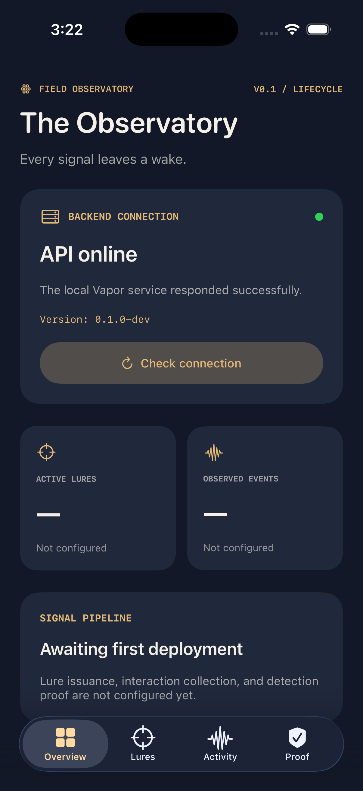
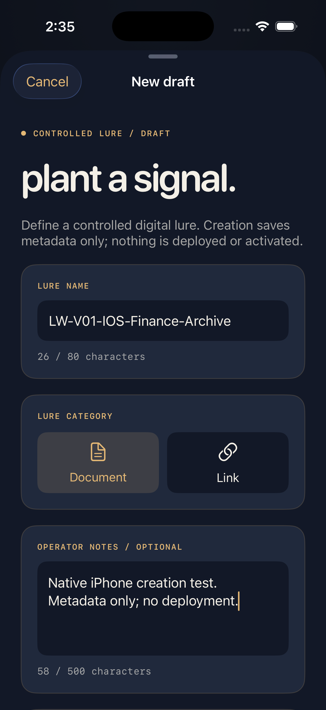
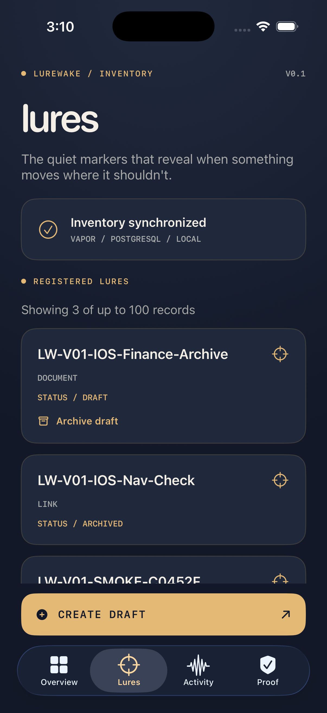
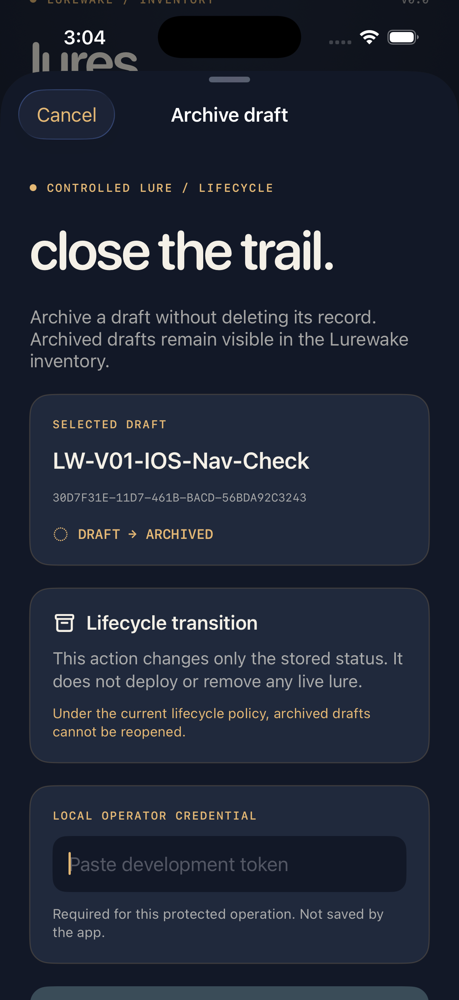
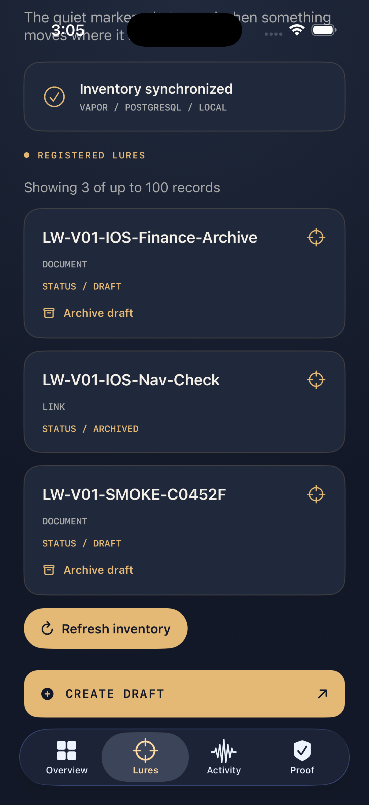

# Lurewake

### Plant the lure. Follow the wake. Prove the signal.

**A native Swift deception-assurance project for controlled digital lures and detection-pipeline validation.**

Lurewake is being developed as a security engineering tool for creating authorized digital lures, observing interactions, and eventually producing evidence that security detections work as intended.

The project's visual language is inspired by nocturnal moths, quiet signals, and the trails left behind when something unexpected moves through an environment.

**Current release:** v0.1 — Controlled Lure Lifecycle  
**Stack:** SwiftUI · Swift Vapor 4 · PostgreSQL · Docker  
**Platform:** Native iPhone application with a separate backend  
**Maturity:** Local development prototype — not production-ready

> **The lure is the marker. The wake is the observable response. Proof is the evidence that the detection pipeline worked.**
>
> v0.1 establishes the first part of this system: validated, authenticated management of lure-draft records.

---

## The Observatory

The iPhone application uses a cohesive visual system of midnight navy, muted indigo, warm signal gold, and parchment typography.

Its interface is designed around the idea of a field observatory rather than a conventional administration dashboard.

<p align="center">
  
</p>

The Observatory performs a real HTTP health check against the Vapor backend. Its connection status is not simulated.

The Active Lures and Observed Events panels intentionally remain unconfigured until real deployment and telemetry functionality exists.

---

## The v0.1 workflow

### 01 — Plant a signal

Create a new draft directly from the native iPhone app.

A draft contains a name, category, optional operator notes, and a server-managed lifecycle status.

<p align="center">
  
</p>

Supported draft categories:

- `document`
- `link`

Both categories currently represent **metadata**, not actual deployed documents or tracking links.

The backend validates draft names, allowed categories, and note lengths before writing any record.

### 02 — Inspect the field

Created drafts appear in the Lures inventory, which reads its data from PostgreSQL through the Vapor API.

<p align="center">
  
</p>

The inventory distinguishes between draft and archived records.

A successful creation refreshes the inventory without forcing the user back to the Overview tab.

Records remain available across app restarts because PostgreSQL owns the persistent state.

### 03 — Close the trail

Operators can archive a draft through a protected lifecycle action.

Archiving retains the record and changes its status from `draft` to `archived`.

| Archive confirmation | Archived inventory |
|:---:|:---:|
|  |  |

Once archived, a record remains visible in the inventory but no longer offers the Archive action.

The current lifecycle policy does not allow archived records to be reopened.

---

## What works in v0.1

| Capability | Status |
|---|---|
| Native SwiftUI application | Implemented |
| Four-tab navigation | Implemented |
| Shared Lurewake design system | Implemented |
| Backend health checking | Implemented |
| PostgreSQL readiness checking | Implemented |
| Database-backed lure inventory | Implemented |
| Validated document/link draft metadata | Implemented |
| Authenticated draft creation | Implemented for local development |
| Draft-to-archived lifecycle | Implemented |
| Protected archive operation | Implemented |
| iPhone creation and archival workflows | Implemented |
| API and database regression tests | 26 passing locally |
| Real lure issuance and deployment | Planned |
| Interaction event ingestion | Planned |
| Detection-pipeline verification | Planned |
| Evidence collection and exports | Planned |

The Activity and Proof tabs are intentionally placeholders for future milestones.

No operational detection or real-world monitoring capability is claimed for v0.1.

---

## Architecture

```text
                 LUREWAKE v0.1
             CONTROLLED LURE LIFECYCLE

            Native SwiftUI iPhone App
             ┌───────────────────┐
             │ Observatory       │
             │ Lure Inventory    │
             │ Draft Creation    │
             │ Draft Archival    │
             └─────────┬─────────┘
                       │
                    URLSession
                       │
                       ▼
                 Swift Vapor 4
             ┌───────────────────┐
             │ Health / Ready    │
             │ Inventory API     │
             │ Draft Validation  │
             │ Operator Auth     │
             │ Lifecycle Policy  │
             └─────────┬─────────┘
                       │
                      Fluent
                       │
                       ▼
                 PostgreSQL 17
                 Docker Compose
```

The backend owns validation, protected mutations, lifecycle rules, and durable storage.

The iPhone app provides the operator experience but is not the authoritative source of security telemetry.

### Technology

- Swift 6.2
- SwiftUI and Xcode 26.2
- Vapor 4
- Fluent ORM
- FluentPostgresDriver
- PostgreSQL 17
- Docker Compose
- Swift Testing
- Swift Crypto
- GitHub Actions

---

## Run locally

These instructions target macOS with Xcode, Swift, Docker Desktop, and an iOS simulator installed.

The current development configuration uses local loopback networking. It is not intended for a physical iPhone or a public deployment.

### 1. Clone

```bash
git clone git@github.com:danielguillaumont/lurewake.git
cd lurewake
```

### 2. Configure local secrets

On a fresh checkout, generate credentials in a Git-ignored `.env` file:

```bash
if [ ! -f .env ]; then
    umask 077
    printf 'LUREWAKE_DB_PASSWORD=%s\nLUREWAKE_OPERATOR_TOKEN=%s\n' \
      "$(openssl rand -hex 24)" \
      "$(openssl rand -hex 32)" > .env
fi

chmod 600 .env
git check-ignore .env
```

Do not commit `.env` or paste its secret values into issues, pull requests, logs, or screenshots.

### 3. Start PostgreSQL

Start Docker Desktop, then:

```bash
docker compose up -d --wait db
docker compose ps
```

The database is available on `127.0.0.1:5433`.

### 4. Migrate and run the backend

From the repository root:

```bash
set -a
source .env
set +a

swift run --package-path services/api LurewakeAPI migrate --yes
swift run --package-path services/api LurewakeAPI serve
```

Leave the server Terminal window open.

In a second Terminal window:

```bash
curl -fsS http://127.0.0.1:8080/health
curl -fsS http://127.0.0.1:8080/ready
curl -fsS http://127.0.0.1:8080/api/v1/lures
```

`/health` confirms API availability, while `/ready` verifies PostgreSQL connectivity.

### 5. Launch the iPhone app

```bash
open apps/LurewakeIOS/Lurewake/Lurewake.xcodeproj
```

Choose the **Lurewake** scheme, select an **iPhone 17 Pro** simulator, and press **Command + R**.

Open the Lures tab to create and archive draft records.

Protected operations prompt for the operator token from the local `.env` configuration. The native interface does not persist that token.

---

## API

| Method | Endpoint | Description |
|---|---|---|
| `GET` | `/health` | Backend health |
| `GET` | `/ready` | Database readiness |
| `GET` | `/api/v1/lures` | Retrieve inventory |
| `POST` | `/api/v1/lures` | Create a validated draft |
| `PATCH` | `/api/v1/lures/:lureID/archive` | Archive a draft |

Mutating endpoints require a configured development bearer token.

Important HTTP responses include:

- `201` — draft created
- `200` — archive succeeded
- `400` — malformed input
- `401` — missing or rejected credentials
- `404` — lure not found
- `409` — invalid lifecycle transition

The inventory endpoint currently returns up to 100 records.

---

## Testing and verification

### Build the iOS app

```bash
xcodebuild \
  -project apps/LurewakeIOS/Lurewake/Lurewake.xcodeproj \
  -scheme Lurewake \
  -configuration Debug \
  -sdk iphonesimulator \
  -destination 'generic/platform=iOS Simulator' \
  CODE_SIGNING_ALLOWED=NO \
  build
```

### Build and test the Vapor API

```bash
swift build --package-path services/api
swift test --package-path services/api
```

### Run the PostgreSQL integration tests

Start the database first. If the dedicated test database does not yet exist, create it:

```bash
docker compose exec -T db sh -c \
  'PGPASSWORD="$POSTGRES_PASSWORD" psql \
  -X -U "$POSTGRES_USER" -d "$POSTGRES_DB" \
  -v ON_ERROR_STOP=1' <<'SQL'
SELECT 'CREATE DATABASE lurewake_test'
WHERE NOT EXISTS (
    SELECT 1 FROM pg_database
    WHERE datname = 'lurewake_test'
)\gexec
SQL
```

Then:

```bash
(
    set -a
    source .env
    export LUREWAKE_RUN_DB_TESTS=1
    set +a

    swift test --package-path services/api
)
```

The database tests use `lurewake_test`, verify real PostgreSQL persistence, and clean up their temporary records.

**Last verified local result — November 3, 2026:** 26 backend tests passed, zero failures, zero skips. The iOS and Vapor builds also passed.

GitHub Actions provides the separate pull-request CI verification.

---

## Security considerations

Lurewake v0.1 is a local-development prototype, not a production-ready security service.

- Creation and archival require a server-configured operator bearer token.
- The single-token authentication model is for local development, not production identity management.
- The inventory endpoint currently does not require authentication.
- Credentials must not be transmitted over untrusted networks using plain HTTP.
- The API should remain bound to a trusted loopback environment.
- No user activity is tracked, collected, or analyzed in v0.1.
- No real digital lures are deployed.
- Draft records are metadata only.
- Testing must be restricted to systems and environments the operator is authorized to control.

Production use would require a redesigned authentication model, transport security, access controls, operational auditing, and deployment hardening.

---

## Roadmap

**v0.0 — Foundation:** Native shell, observatory, API health, PostgreSQL infrastructure, and inventory.

**v0.1 — Controlled Lure Lifecycle:** Validated draft creation, authenticated mutation endpoints, persistent status transitions, and native workflows.

**Future milestones:** Authorized lure issuance, interaction telemetry, event correlation, detection-assurance checks, and evidence exports.

Those future capabilities are design objectives, not completed features.

---

## Repository layout

```text
apps/LurewakeIOS/        Native iPhone application
services/api/            Swift Vapor backend and tests
docs/decisions/          Architecture decision records
docs/environment.md      Development environment
docs/evidence/v00/       Foundation verification
docs/evidence/v01/       Lifecycle screenshots and evidence
.github/workflows/       Continuous integration
compose.yaml             Local PostgreSQL configuration
```

---

**Lurewake** — *Every signal leaves a wake.*
