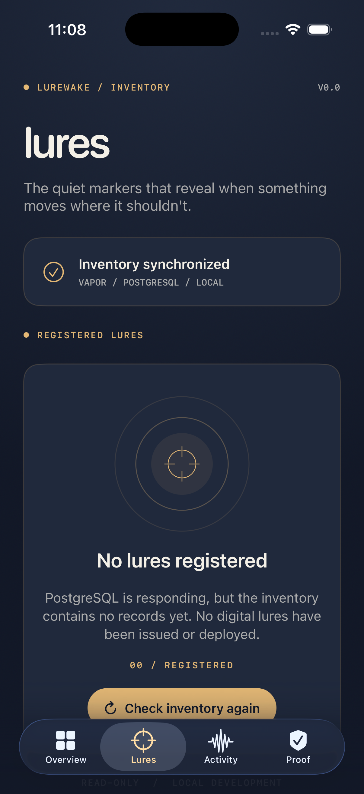
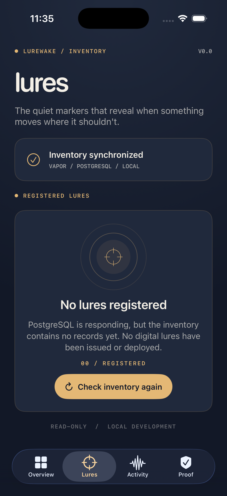

# V0.0 — Native Lures Inventory Integration

Date: 2026-11-02
Branch: feat/v00-foundation

## Objective

Connect the native SwiftUI Lures screen to the
real PostgreSQL-backed Vapor inventory API.

## Implementation

- Native LuresInventoryView
- Shared Lurewake visual design system
- GET /api/v1/lures integration
- Asynchronous URLSession request
- Loading, empty, populated, and error states
- Pull-to-refresh and manual retry
- Read-only local development interface

## Verified Results

- iOS simulator build: PASS
- iPhone 17 Pro application launch: PASS
- Lures navigation: PASS
- API inventory synchronization: PASS
- Empty inventory display: PASS
- Backend unavailable state: PASS
- Connection recovery: PASS

## Evidence

## Security Boundaries

The screen reads backend-owned inventory records.

An unavailable API is reported as a connection
failure, not as evidence that no lures exist.

No issuance, deployment, event ingestion,
or detection verification is implemented yet.

Authentication and authorization remain pending.
The development API is not intended for
public network exposure.

## Next Step

Add database-backed automated integration tests
and controlled draft-lure functionality.

## Final V0.0 Layout Verification

Date: 2026-11-02

The native inventory empty state was refined to
improve vertical spacing and safe-area clearance.

### Verified

- iPhone 17 Pro simulator: PASS
- iOS simulator build: PASS
- Build exit code: 0
- Empty inventory displayed correctly: PASS
- Inventory connection indicator visible: PASS
- Refresh button unobstructed: PASS
- Bottom navigation unobstructed: PASS

### Screenshot

### Remaining UI Checks

Additional simulator sizes, Dynamic Type scaling,
and VoiceOver accessibility remain to be audited.

No detection capability is implied by this screen.
