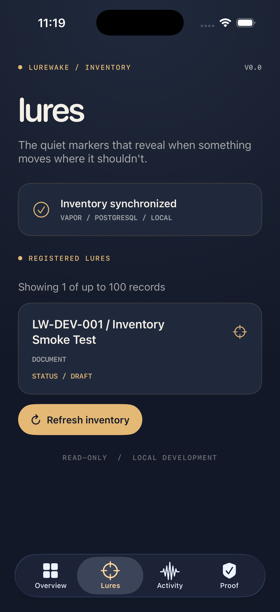

# V0.0 — Populated Lure Inventory Smoke Test

Date: 2026-11-02
Branch: feat/v00-foundation

## Objective

Verify that Lurewake retrieves a real PostgreSQL
lure record through the Vapor inventory API.

## Test Fixture

Name: LW-DEV-001 / Inventory Smoke Test
Kind: document
Status: draft
ID: 00000000-0000-4000-8000-000000000042

This was a temporary local development record.

It was not an issued or deployed lure.

## Verified Results

- PostgreSQL container healthy: PASS
- Initial empty inventory: PASS
- Draft database insertion: PASS
- Insertion exit code: 0
- API returned one saved record: PASS
- returnedCount: 1
- Record fields matched database: PASS
- Test fixture deletion: PASS
- Cleanup exit code: 0
- Remaining database records: 0

## iOS Screenshot

The screenshot was captured during the
populated-inventory test.

## Security Boundaries

The record was inserted directly into the
local development database.

No public creation endpoint was introduced.

No lure was deployed, activated, or interacted with.

No detection event or security alert was generated.

## Next Steps

- Automate database integration tests
- Improve native inventory layout
- Update project documentation
- Review v0.0 foundation for PR and merge
