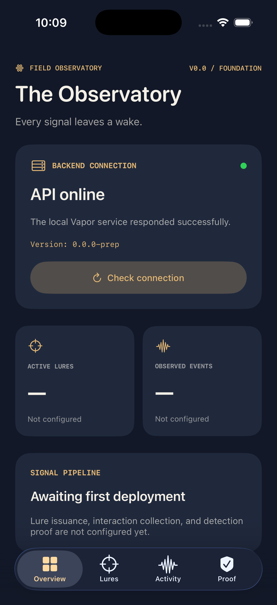

# V0.0 — Observatory Integration Smoke Test

Date: 2026-11-02
Branch: feat/v00-foundation

## Objective

Verify that the native Lurewake iOS application
can communicate with the independent Vapor backend.

## Verified Results

- iPhone 17 Pro simulator: PASS
- Observatory dashboard rendered: PASS
- iOS application build: PASS
- Vapor backend started: PASS
- HTTP GET /health: 200 OK
- Native app-to-backend communication: PASS
- API service identifier: lurewake-api
- API version: 0.0.0-prep

## Evidence

## Architecture Validation

The iOS application uses URLSession to request
backend health information.

Vapor independently responds to the health request.

The dashboard displays the service's actual
response instead of hardcoded connection status.

## Limitations

The health endpoint verifies API liveness only.

PostgreSQL, lure issuance, event collection,
and detection validation are not implemented.

## Next Milestone

Introduce PostgreSQL and reproducible
Docker Compose infrastructure.
